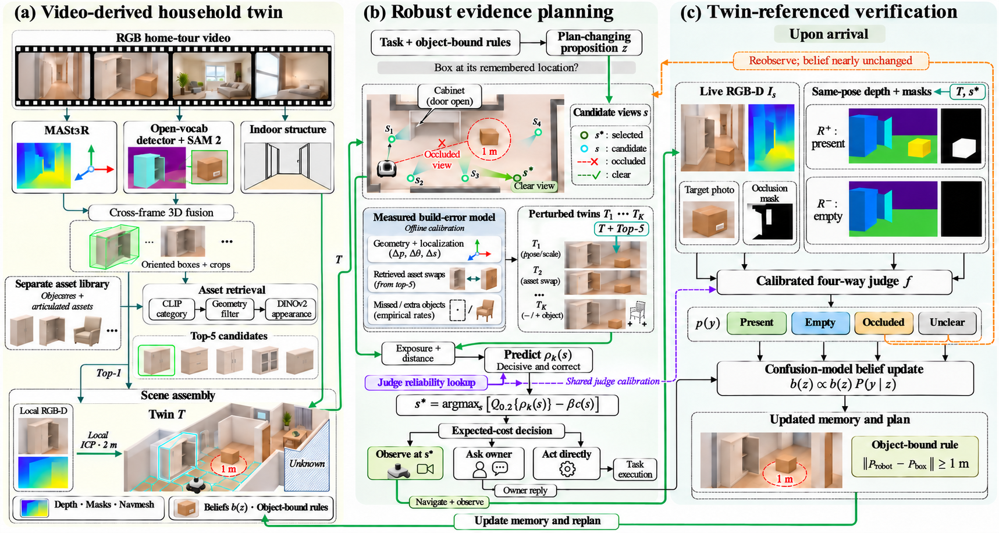

# 孪生参照的家庭任务取证

面向 co-author 的方案讨论文档 · 整理日期：2026-11-03

## 一句话说明

给家用机器人建一个简化的虚拟家庭。机器人出发前用它选择观察位置，到达后用它生成判断参照，确认家里的当前情况，再执行任务、更新记忆和长期要求。

当前处于方案阶段。下文的方法、工具组合和实验设置是计划；原型、离线评测和在线实验尚未完成。

## 要解决的问题

家里的东西会移动，也会被柜门、椅子等遮挡。机器人记住的位置可能过时，而“没看见”不能直接说明“已经不在”。

例如，主人要求机器人经过某个纸箱时保持一米距离。后来机器人去卧室找水杯，在走廊看不到纸箱：纸箱可能搬走了，也可能仍被柜门挡着。判断错误会造成两种后果：违反要求，或者无谓绕路。

我们想验证：一个有误差的简化家庭模型，能否帮助机器人用较少的观察分清这些情况。

## 方法框架图



- **图 (a)：建立简化家庭模型。** 从导览视频估计结构和物体，检索现成三维资产并拼装；任务附近的几何用 RGB-D 局部修正。
- **图 (b)：决定下一步怎么确认。** 在多个可能有偏差的孪生中比较观察位置，再比较去看、问主人和直接执行的代价。
- **图 (c)：解释实际观测。** 对照实拍和“目标在／目标不在”的参照，判断在、空、挡住或看不清，更新记忆并重新规划。

图中的场景、深度图和路线是机制示意。完整图注、箭头说明和来源见[框架图说明](figures/README.md)。

## 文档目录

| 章节 | 阅读后应能回答的问题 | 包含内容 |
| --- | --- | --- |
| [01 问题与任务](docs/01-problem.md) | 我们具体解决什么问题？ | 纸箱例子、任务范围、变化类型、第一阶段假设、两类错误 |
| [02 核心 idea](docs/02-idea.md) | 为什么一个简化模型可能有帮助？ | 孪生的两种用途、模型误差、只检查相关信息、核心假设 |
| [03 具体方法](docs/03-method.md) | 系统如何从输入走到行动？ | 按图 (a)(b)(c) 解释流程、输入输出、评分、四类判断、记忆与要求更新 |
| [04 工具与实现](docs/04-tools.md) | 每个环节准备由什么实现？ | UrbanVerse、Jev、重建／检测／检索工具、资产库、渲染器、仿真平台、待定项 |
| [05 相关工作](docs/05-related-work.md) | 借用了什么，主要和谁比较？ | 论文与官方来源、借鉴部分、对照作用、查新问题 |
| [06 验证计划](docs/06-evaluation-plan.md) | 要用什么证据判断方案是否值得继续？ | 站位与建模检查、判断模型评测、完整任务评测、消融、指标和实施顺序 |
| [07 待讨论问题](docs/07-open-questions.md) | 这次 co-author 讨论要决定什么？ | 按优先级列出具体问题、影响和所需证据 |
| [08 设计约定与决策记录](docs/08-decisions.md) | 当前哪些是工作设定，讨论后改了什么？ | 当前设计依据、后续结论的记录方式 |

## 阅读顺序

第一次了解方案：先读本页和框架图，再读 01、02、03。

讨论技术实现：重点读 03、04；讨论论文定位：重点读 02、05；讨论投入和可验证性：重点读 06。会议集中处理 07，形成的结论写入 08。

## 仓库结构

```text
home-twin-discussion/
├── README.md
├── CONTRIBUTING.md
├── docs/
│   ├── 01-problem.md
│   ├── 02-idea.md
│   ├── 03-method.md
│   ├── 04-tools.md
│   ├── 05-related-work.md
│   ├── 06-evaluation-plan.md
│   ├── 07-open-questions.md
│   └── 08-decisions.md
├── figures/
│   ├── home-twin-framework.png
│   └── README.md
├── .github/
│   ├── ISSUE_TEMPLATE/
│   │   └── research-discussion.md
│   └── pull_request_template.md
└── .gitignore
```

这个目录可整体作为 GitHub 仓库根目录。所有正文和图片都使用相对路径，不依赖本地工作区。若并入已有仓库，Issue 和 PR 模板需要放到该仓库根目录的 `.github/` 中。

讨论和修改方式见 [CONTRIBUTING.md](CONTRIBUTING.md)。本目录包含说明文档和框架图；运行代码、模型权重和实验数据待实现后加入。

## 内容依据

方法整理自 2026-11-03 的 `prototype-plan.md` 与 `decisions.md`，框架图采用同日对应方案的成图。Jev 的图像能力按 2026-10-14 官方公告说明，具体来源见 [05 相关工作](docs/05-related-work.md)。

本目录中的“当前设计”表示供共同讨论的方案，不表示实验结论或 co-author 已达成共识。
