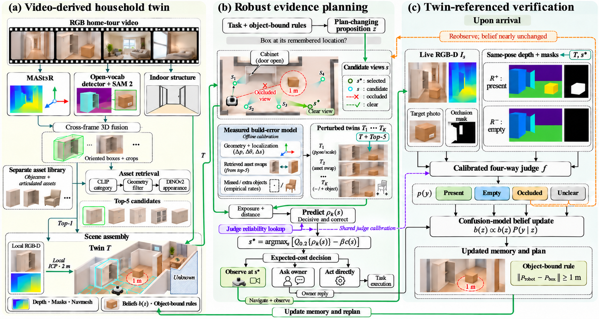

# 历史方法框架图

[返回当前方案](../README.md) · [当前具体方法](../docs/03-method.md)

**本图对应 2026-11-03 方案，保留作讨论记录。2026-11-04 的当前方法图待重绘。**

## 图中表达的旧方案

(a) 从导览视频估计结构与物体，检索三维资产，使用第一名拼装名义孪生，保留前五名用于扰动；附近几何通过 RGB-D 与 ICP 修正。

(b) 对会改变动作或回答的命题，结合建图误差与判断器标定比较观察位置，再选择观察、询问或直接执行。

(c) 实拍、目标照片、遮挡掩码与同位姿的在场／空场深度参照共同进入四类判断，随后更新信念和要求状态。

## 与当前方案的差别

| 图中内容 | 当前方案 |
| --- | --- |
| 资产拼装的家庭孪生为主表示 | 视频重建的语义三维地图为主表示 |
| 第一名资产拼装，其他资产用于扰动 | 资产补未知部分，多个可能场景服从已有观测 |
| 渲染参照作为到站判断的固定输入 | 参照是可选输入，由消融决定是否保留 |
| 标定表直接进入评分 | 几何检查先行，完成判断器校准后验证完整评分 |

当前流程与反馈关系以 [03 具体方法](../docs/03-method.md) 为准。该 PNG 尚未重绘，不应直接放进描述当前方法的论文或报告。

## 文件与来源

- 文件：`home-twin-framework.png`，1717 × 916 像素的栅格图。
- 对应内容：2026-11-03 原型方案。
- 生成方式：按 FigureForge 的内容映射、生成与检查流程绘制，图像由 AI 生成。
- 版式参考：[UrbanVerse](https://arxiv.org/html/2510.15018) 方法图，参考图来自 [topconf-paper-figure-gallery](https://github.com/qwdwqfwq/topconf-paper-figure-gallery)。
- 场景、深度和路线为机制示意，文字与箭头不能单独编辑。

本目录未附画廊原图、第三方模型或论文 PDF。
